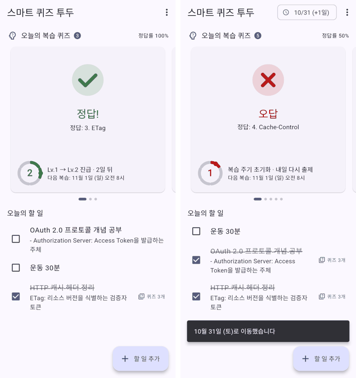
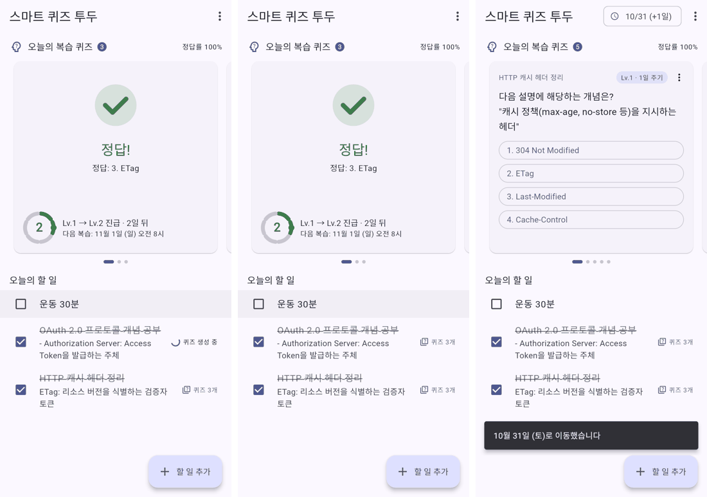
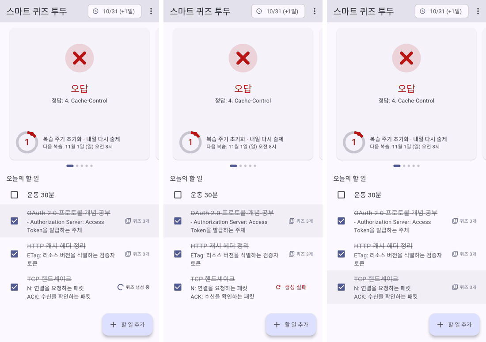

# 동작 검증 보고서

- 검증일: 2026-10-30
- 대상: `lib/main.dart` (설계 문서 v1.0 기반 구현, 복습 간격 1·2·4·8·16·31일)
- 환경: Flutter 3.47.8 stable / Dart 3.13.7, Linux, Chromium (web 빌드 E2E)

## 요약

| 항목 | 결과 |
|---|---|
| 정적 분석 `flutter analyze` | 경고 0건 |
| 자동 테스트 `flutter test` | **46개 전부 통과** (unit 33, widget 13) |
| 라인 coverage (`lib/main.dart`) | **96.6%** (1028 / 1064) |
| 브라우저 E2E (web 빌드 + Playwright) | 주요 사용자 흐름 7단계 통과, 런타임 오류 0건 |
| Android 빌드 / 실기기 | **미검증**: 이 환경에서 Android SDK 다운로드(`dl.google.com`)가 막혀 있음 |

검증 중 버그 2건을 찾아 수정했습니다(아래 "검증 중 발견·수정한 문제" 참고).

## 다시 돌려보는 방법

```bash
flutter analyze
```

```bash
flutter test
```

```bash
flutter test --coverage
```

## 요구사항별 검증 결과

테스트 파일: `test/main_test.dart`, `test/verification_test.dart`

### 간격 반복 (설계 문서 2절 시나리오 3·4)

| 확인 내용 | 결과 |
|---|---|
| 완료 다음 날 오전 8시에 첫 복습. 월말·연말을 넘어가도 날짜가 맞음 | 통과 |
| 7번 연속 정답일 때 간격이 2 → 4 → 8 → 16 → 31 → 31 → 31일 | 통과 |
| 예정일 **전날에는 출제되지 않고**, 예정일에는 출제됨 (7단계 전부) | 통과 |
| 어느 단계에서든 틀리면 내일(1일)로 초기화 | 통과 |
| 복습을 며칠 놓쳐도 밀린 퀴즈는 계속 나오고, 푼 날 기준으로 다시 예약 | 통과 |
| 이미 푼 퀴즈를 같은 날 다시 제출하면 거부. 연타해도 이력이 1건만 남음 | 통과 |

### 비동기 퀴즈 생성 (3절 다이어그램, 4절 SLO, 10절)

| 확인 내용 | 결과 |
|---|---|
| 투두 완료는 즉시 반영되고 퀴즈는 백그라운드에서 생성됨 (0.6초 지연 동안 "퀴즈 생성 중" 표시, 화면 멈춤 없음) | 통과 |
| 시도당 5초 timeout. 시간 초과 후 늦게 도착한 결과로 덮어쓰지 않음 | 통과 |
| LLM 장애 시 재시도 후 "생성 실패" 표시, 투두 완료 상태는 유지, 수동 재시도로 복구 | 통과 |
| 깨진 JSON 응답 → ERROR 로그 후 재시도 (4회 시도 모두 기록) | 통과 |
| 완료 후 메모를 고치면 퀴즈를 새로 만들고, 메모가 같으면 다시 만들지 않음 | 통과 |
| 메모가 없는 투두는 LLM을 호출하지 않음 | 통과 |

### 보안·비용 방어 (7절)

| 확인 내용 | 결과 |
|---|---|
| 다른 사용자의 투두·퀴즈는 조회·제출·숨기기·내보내기 불가 (404) | 통과 |
| 완료를 껐다 켜기 5번 반복해도 LLM 호출은 1번 | 통과 |
| 사용자별 분당 생성 한도를 넘으면 "한도 초과" + WARN 로그 | 통과 |
| prompt injection 문구(영어·한국어), `</memo>` 구분자 탈출, 제어문자 제거, 메모 1,500자 상한 | 통과 |
| 메모 원문이 어떤 로그에도 남지 않음 | 통과 |
| 가져오기: 1MB 초과, 500개 초과, 지원하지 않는 버전, 범위를 벗어난 정답 번호는 거부 | 통과 |

### 화면·상호작용 (5절)

| 확인 내용 | 결과 |
|---|---|
| 정답 선택 → 카드 뒤집힘 → 초록 체크 + Lv.1 → Lv.2 진급 표시 | 통과 (widget + 브라우저) |
| 오답 선택 → 빨간 X + "복습 주기 초기화 · 내일 다시 출제" | 통과 (widget + 브라우저) |
| 스와이프로 카드 전환 (`onQuizWidgetSlide` 로그) | 통과 (widget 테스트만, 아래 한계 참고) |
| 퀴즈 미노출·신고 메뉴 → 목록에서 빠지고 신고 기록 남음 | 통과 |
| 할 일 추가, 메모 수정, 밀어서 삭제 (퀴즈는 남음) | 통과 |
| v1.1 JSON 내보내기 대화상자 / 가져오기 (오류 안내 + 즉시 출제) | 통과 |
| 서버 제출 실패 시 "기록 실패" 표시 + ERROR 로그 | 통과 |
| `CustomPainter`는 입력이 같으면 `shouldRepaint`가 false | 통과 |
| 360dp 폭에서 레이아웃 overflow 없음 | 통과 |

## 브라우저 E2E 화면

정답과 오답 결과 (오답은 다음 날 출제분에서 선택):



투두 완료 → 퀴즈 생성 중 → 퀴즈 3개 → 하루 뒤 이동 시 복습 5개(남은 HTTP 2개 + OAuth 3개):



LLM 장애: 생성 중 → 재시도 후 생성 실패 → 장애를 끄고 재시도하면 복구 (투두 체크는 계속 유지):



## 검증 중 발견·수정한 문제

1. **의미 없는 빈칸 퀴즈가 생성됨.** `'오늘 했음'` 같은 메모에서 "_____ 했음"(보기: 오늘/했음) 퀴즈가 만들어졌습니다. 설계 문서 9절이 걱정한 "무의미한 퀴즈"에 해당합니다. 이제 단어가 3개 미만인 문장으로는 빈칸 퀴즈를 만들지 않고 "퀴즈 소재 부족"으로 표시합니다.
2. **오답 보기가 설명 속 단어에서 나옴.** `'TTL: 남은 수명'`에서 "'남은 수명'에 해당하는 개념은?"을 물으면서 오답 보기에 "남은", "수명"이 들어갔습니다. 이제 설명에 나온 단어는 오답 보기에서 뺍니다.

## 검증하지 못한 것 / 한계

- **Android 빌드와 실기기 동작:** Android SDK를 받을 수 없어 `flutter build apk`와 에뮬레이터 실행은 하지 못했습니다. 직접 확인할 때는 다음을 실행하세요.

  ```bash
  flutter build apk --debug
  ```

  ```bash
  flutter run --profile
  ```

- **60 FPS 실측:** headless 환경이라 프레임 시간을 측정하지 않았습니다. 코드 구조(애니메이션 중 리빌드 없음, `RepaintBoundary`, `shouldRepaint`)만 확인했습니다. 실기기에서 DevTools Performance 탭으로 확인이 필요합니다.
- **마우스로 카드 넘기기:** Flutter 기본 설정상 PageView는 터치와 트랙패드로만 넘어가고 마우스 드래그로는 넘어가지 않습니다. Android(터치)에서는 문제없지만 web이나 데스크톱 데모에서는 넘길 수 없습니다. 브라우저 E2E에서도 이 단계는 확인하지 못했습니다.
- **브라우저 E2E의 텍스트 입력:** 자동 입력 중 Tab으로 포커스를 옮긴 직후 메모 첫 글자가 빠지는 현상이 있었습니다("SYN:" → "N:"). widget 테스트의 입력은 정상이라 자동화 도구의 타이밍 문제로 보지만, 실기기 키보드로 한 번 확인하는 것이 좋습니다.
- **실제 서버·LLM·푸시:** 백엔드, 실제 LLM, FCM 푸시는 아직 없고 앱 내 대체 구현으로만 검증했습니다. AES-256 암호화, Postgres RLS, VPC 분리는 서버 구현 후 별도 검증이 필요합니다.
- **O/X 퀴즈 품질:** 메모에 개념이 하나뿐이고 오답 보기로 쓸 단어가 없으면 항상 정답이 "O"인 퀴즈가 만들어집니다. 오프라인 대체 생성기의 한계이며, 실제 LLM으로 바꾸면 해소됩니다.
- **데이터 저장:** 데이터가 메모리에만 있어 앱을 재시작하면 초기화됩니다.
